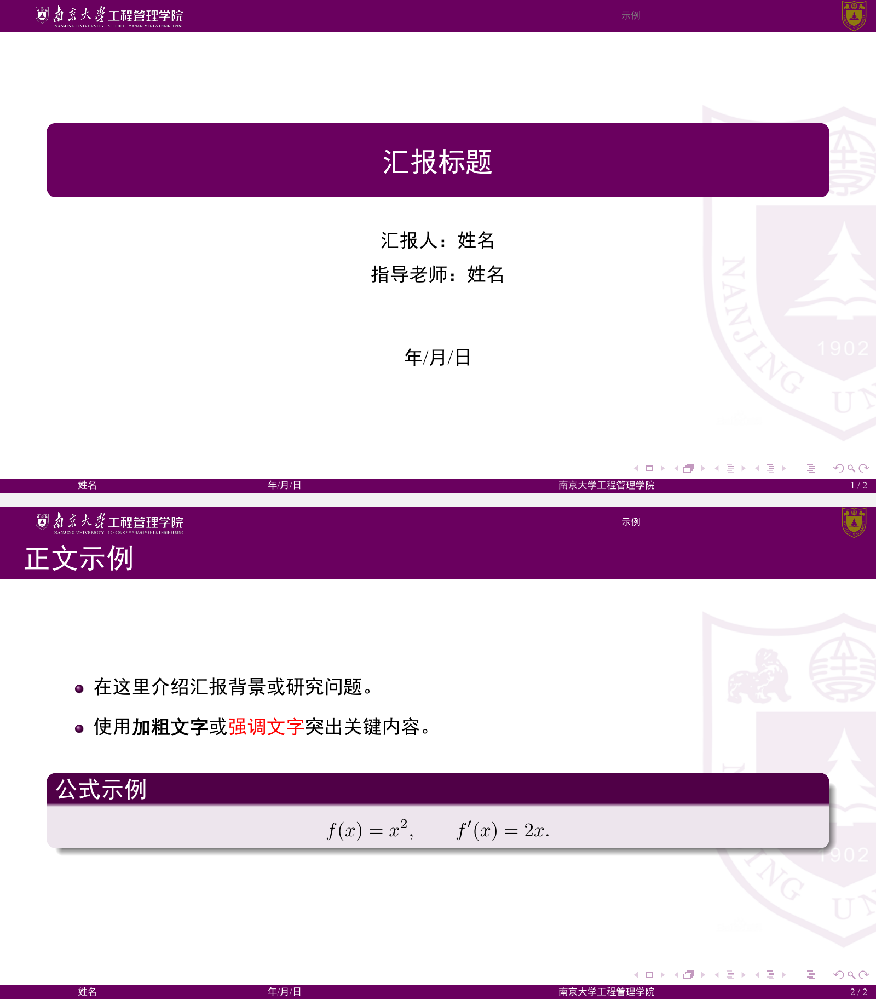

# nju_sme_beamer

南京大学工程管理学院 Beamer 模板，适用于组会、课程汇报和学术报告。

本项目基于已有的南大 Beamer 模板整理，保留原有的 **16:9 比例、紫色配色、校院标识、页眉导航和页脚**。背景水印调淡至 30% 不透明度。示例共两页：封面和正文，所有汇报信息均为占位文字。



[查看示例 PDF](sample.pdf)

## 快速开始

1. 下载本仓库的 ZIP 并解压，或运行：

   ```sh
   git clone https://github.com/qby1210/nju_sme_beamer.git
   cd nju_sme_beamer
   ```

2. 编辑 `main.tex` 中的标题、汇报人、指导老师和日期。
3. 使用 **XeLaTeX 编译两次**：

   ```sh
   xelatex -interaction=nonstopmode -halt-on-error -no-shell-escape main.tex
   xelatex -interaction=nonstopmode -halt-on-error -no-shell-escape main.tex
   ```

最终文件为 `main.pdf`。两次编译用于更新页眉导航和总页数。

### 编译环境

使用完整的 TeX Live 或已安装相关宏包的 MiKTeX，需要 Beamer、CTeX、xeCJK、fontspec、PGF/TikZ、listings 和 booktabs。模板使用 XeLaTeX，不使用 pdfLaTeX，也不需要启用 shell escape。

字体配置位于 `fonts.tex`：

| 类型 | 优先字体 | 回退字体 |
| --- | --- | --- |
| 西文正文 | Times New Roman | TeX Gyre Termes |
| 西文等宽 | Consolas | Latin Modern Mono |
| 中文宋体 | Source Han Serif SC、SimSun | FandolSong |
| 中文黑体 | Source Han Sans SC、SimHei | FandolHei |
| 中文等宽 | Source Han Serif SC、FangSong | FandolFang |

完整的 TeX Live 提供回退字体，因此模板不依赖 Windows 专有字体。不同系统选择不同字体时，字形会有细微差异。

### Windows PowerShell

如果 `xelatex` 已加入 PATH：

```powershell
.\build.ps1
```

如果未加入 PATH，可明确指定安装位置：

```powershell
.\build.ps1 -XeLaTeX 'C:\texlive\2026\bin\windows\xelatex.exe'
```

按实际安装路径替换上面的路径。

### macOS / Linux

直接使用上面的 XeLaTeX 命令，或运行：

```sh
make
```

`make clean` 清理中间文件并保留生成的 PDF。

### Overleaf

新建空项目，将仓库中的 `.tex`、`.sty` 和校院图片文件上传至项目根目录，将主文件设置为 `main.tex`，编译器选择 **XeLaTeX**。

## 填写自己的内容

封面信息在 `main.tex` 中集中设置：

```tex
\title[简短标题]{汇报标题}
\author[姓名]{\texorpdfstring{%
  汇报人：姓名
  \vspace{0.2cm}\\
  指导老师：姓名}{姓名}}
\date[2026/10/15]{2026年10月15日}
```

方括号中的短名称用于页脚或导航。无需指导老师时，可以删除对应行。`\texorpdfstring` 的第二个参数是 PDF 作者属性中的姓名，修改姓名时同步替换。PDF 标题由 Beamer 根据 `\title` 自动生成，其余属性由 `\hypersetup` 设置。

新增正文页面：

```tex
\section{研究背景}
\begin{frame}{研究背景}
  \begin{itemize}
    \item 第一条要点。
    \item 第二条要点。
  \end{itemize}
\end{frame}
```

主题支持章节导航、列表、数学公式、圆角内容块和代码排版。图片可使用 `\includegraphics` 插入；包含 `lstlisting` 等逐字内容的页面应使用 `\begin{frame}[fragile]{标题}`。

### 调整背景水印

`main.tex` 中的这一行控制背景不透明度：

```tex
\newcommand{\njusmeBackgroundOpacity}{0.30}
```

取值范围为 `0` 到 `1`，数值越小越淡。此设置只作用于背景水印，页眉的学院标识和校徽保持清晰。原始主题和图片资源保留原样。

## 文件结构

| 文件 | 用途 |
| --- | --- |
| `main.tex` | 可编辑的两页最小示例和汇报信息 |
| `fonts.tex` | 跨平台字体选择 |
| `nju.sty` | 南京大学工程管理学院主题 |
| `njulogo.pdf` | 南京大学校徽 |
| `njusme.png` | 工程管理学院标识 |
| `njuname.png` | 南京大学字标，原主题保留资源 |
| `njubackground.png` | 背景水印原图 |
| `build.ps1`、`Makefile` | Windows 和 macOS / Linux 编译入口 |
| `sample.pdf`、`preview.png` | 预编译示例和预览 |
| `LICENSE`、`THIRD_PARTY.md` | 许可和上游来源 |

## 来源与许可

主题沿用了 [EagleBear2002/NJUSE-Beamer-Template](https://github.com/EagleBear2002/NJUSE-Beamer-Template) 的结构，该项目又基于 [YLiu1231/njumath_beamer](https://github.com/YLiu1231/njumath_beamer)。本版本使用工程管理学院标识和页脚文字，并将具体汇报整理为通用示例。

模板代码采用 MIT 许可，并保留上游版权声明，详见 [LICENSE](LICENSE) 和 [THIRD_PARTY.md](THIRD_PARTY.md)。校名、校徽及学院标识的相关权利归原权利人所有。本项目为社区整理的汇报模板。
